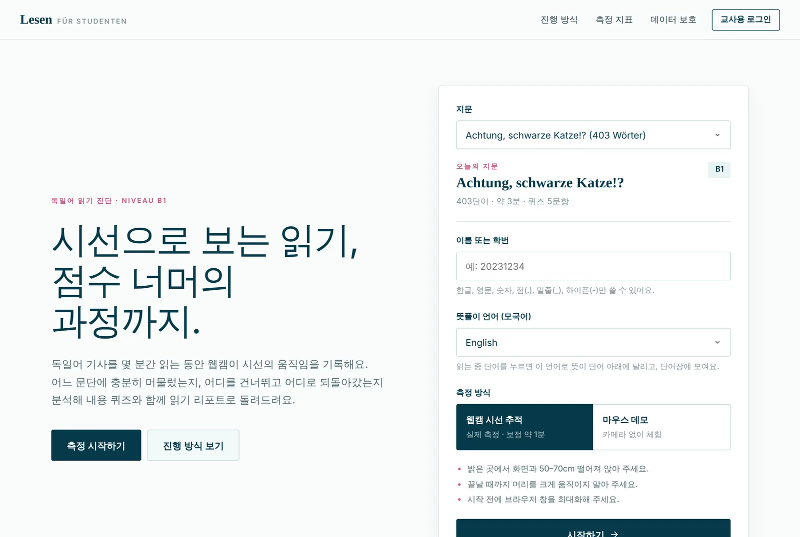
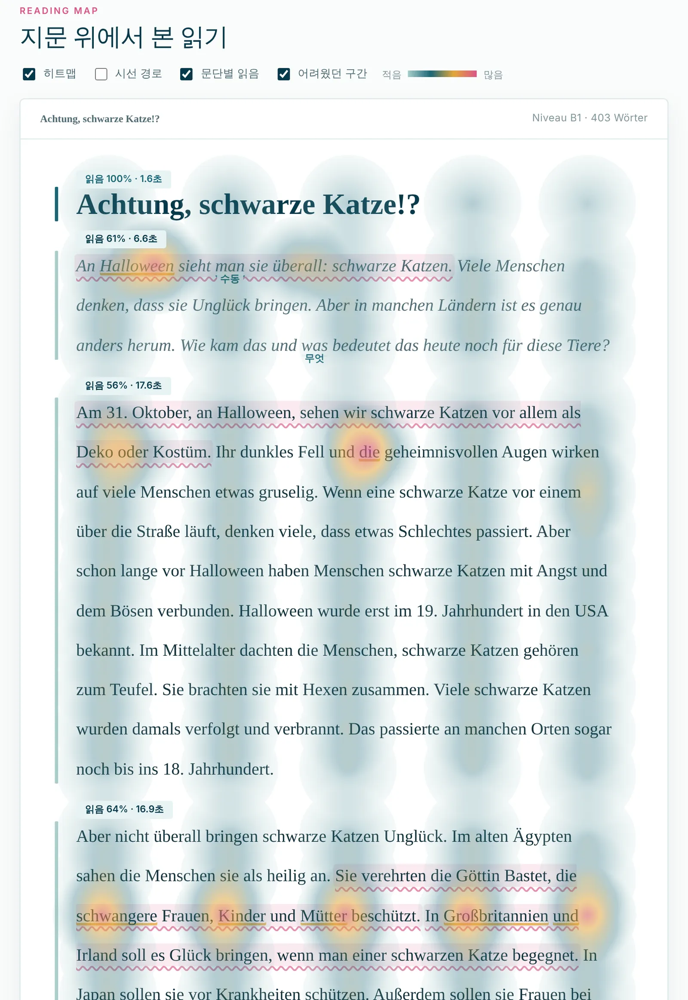
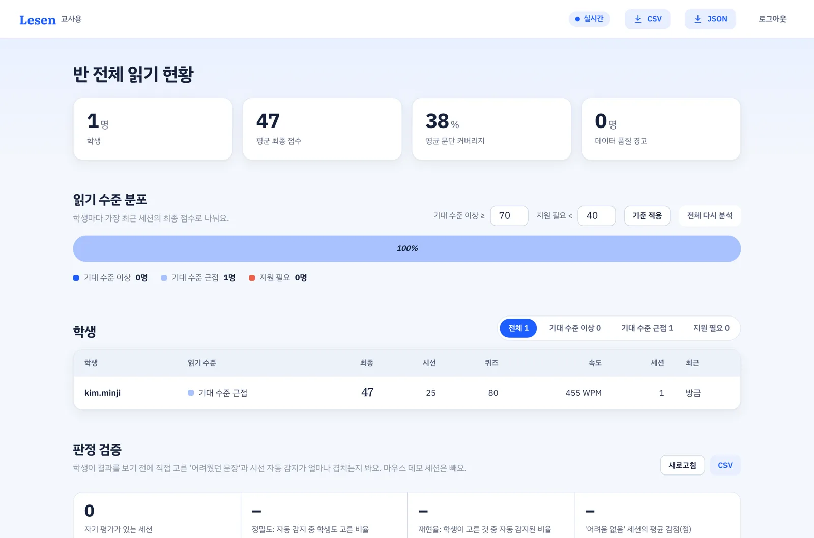
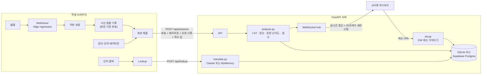

# Lesen für Studenten

[](https://github.com/GHLee1016/Lesen-Fuer-Studenten/actions/workflows/ci.yml)

웹캠 시선 추적으로 **독일어 읽기 과정**을 기록하고 분석하는 웹 애플리케이션입니다.
학생이 기사를 읽는 동안 시선이 어느 문단에 얼마나 머물렀는지, 어디를 건너뛰고 어디로 되돌아갔는지, 어느 문장에서 막혔는지를 측정하고, 내용 퀴즈와 합쳐 점수를 냅니다. 모르는 단어는 눌러서 모국어 뜻을 바로 보고 단어장에 모을 수 있습니다. 교사는 대시보드에서 반 전체 현황과 학생별 읽기 과정을 실시간으로 확인하고 시선을 다시 재생해 볼 수 있습니다.

<p align="center">
  
</p>

## 주요 기능

| | |
|---|---|
| **브라우저 안에서 끝나는 시선 추정** | [WebGazer.js](https://webgazer.cs.brown.edu/)로 시선을 추정합니다. 카메라 영상은 기기를 벗어나지 않고, 서버에는 시선 좌표만 전송됩니다. |
| **검증 가능한 보정** | 9점 클릭 학습 → 9점 응시로 아핀 보정 → **학습에 쓰지 않은 5개 점으로 실제 오차(px)를 측정**합니다. 보정 행렬이 검증 오차를 줄이지 못하면 적용하지 않습니다. |
| **문단 단위 읽기 분석** | I-DT 알고리즘으로 고정(fixation)을 검출하고, 문단별 체류 시간·커버리지, 되돌아 읽기(regression), 읽기 속도(WPM)를 계산합니다. |
| **DW 지문 가져오기** | [DW Deutsch lernen](https://learngerman.dw.com/de/deutsch-lernen) 레슨 주소를 넣으면 본문, CEFR 수준(A1–C1), DW 용어 풀이, 이해도 문제(복수 정답 포함)를 가져옵니다. |
| **단어 뜻풀이와 단어장** | 읽는 중 단어를 누르면 학생이 고른 모국어(14개 언어)로 뜻이 단어 아래에 달리고, 찾아본 단어는 예문과 함께 단어장에 모입니다. CSV로 내려받아 Anki 같은 앱에 넣을 수 있습니다. |
| **어려웠던 구간 자동 탐지** | 자신의 평소 속도보다 훨씬 오래 머문 문장, 읽고 지나간 뒤 다시 돌아온 문장을 찾아 표시하고 시선 점수에서 감점합니다. 학생은 문장을 눌러 직접 표시하거나 해제할 수 있습니다. |
| **교사용 시선 재생** | 학생이 읽은 화면 폭 그대로 지문을 다시 그리고, 시선과 고정 경로를 시간 순서대로 재생합니다. 단어를 찾아본 시점이 타임라인에 표시됩니다. |
| **읽기 리포트** | 읽기 수준, 점수 구성, 단어 기준 읽기 프로필(충분히 읽음·훑어 읽음·건너뜀)과 "다음에 해 볼 것" 안내를 보여 주고, 고정 시간 가중 히트맵·시선 경로·문단별 읽음 정도를 본문 위에 겹쳐 보여 줍니다. |
| **교사용 대시보드** | 최근 점수 기준 읽기 수준 분포(기대 수준 이상·근접·지원 필요), 정렬·필터 가능한 학생 표, 학생별 세션 이력과 문단별 지표, 데이터 품질 경고, CSV/JSON 내보내기. WebSocket으로 실시간 갱신됩니다. |
| **마우스 데모 모드** | 카메라 없이 마우스를 시선으로 삼아 전체 흐름을 체험할 수 있습니다. |

<table>
  <tr>
    <td></td>
    <td></td>
  </tr>
  <tr>
    <td></td>
    <td></td>
  </tr>
  <tr>
    <td></td>
    <td></td>
  </tr>
</table>

## 동작 방식



- 시선 좌표는 **본문(article) 요소의 왼쪽 위 기준**으로 기록합니다. 그래서 스크롤과 무관하게 문단 위치와 바로 비교할 수 있습니다.
- 퀴즈 정답은 서버에만 있고, 채점도 서버가 합니다.

## 분석과 점수

웹캠 시선 추적의 오차는 보통 100–200px로, 단어 하나를 정확히 구분하기는 어렵지만 문장과 문단은 구분할 수 있습니다. 그래서 점수는 **문단**과 **문장** 단위로 계산하고, 단어 단위 결과는 참고용 후보로만 씁니다. 줄 간격을 넓게(2.3배) 잡아 줄을 구분하기 쉽게 했습니다.

1. **고정 검출 (I-DT)**: 분산(가로 폭 + 세로 폭)이 기준 이하로 100ms 이상 유지되는 구간을 하나의 고정으로 봅니다. 기준은 120px이고, 보정 때 측정한 흔들림이 크면 흔들림의 6배까지 넓힙니다. 250ms 넘게 샘플이 끊기면 추적이 끊긴 것으로 보고 구간을 나눕니다.
2. **문단 배정**: 고정 위치가 문단 상자(여유 범위 포함) 안에 있으면 그 문단의 체류 시간에 더합니다.
3. **문단 커버리지**: `min(1, 체류 시간 / 기준 시간)`. 기준 시간은 문단 단어 수를 기준 속도 200 WPM으로 읽을 때 걸리는 시간입니다. 학습자는 이보다 느리게 읽어도 손해가 없고, 대충 훑으면 점수가 낮아집니다.
4. **어려웠던 구간**: 각 고정을 가장 가까운 단어에 배정한 뒤 문장 단위로 모읍니다.
   - **오래 머문 문장**: 단어당 체류 시간이 그 학생의 문장 중앙값의 2배 이상이고, 5단어 이상이며, 1.2초 이상 머문 문장
   - **다시 읽은 문장**: 지금까지 읽은 가장 아래 줄보다 2줄 이상 위로 돌아가 0.5초 이상 머문 문장
   - **단어 후보**: 그 학생의 단어 체류 시간 중앙값의 3.5배(최소 0.7초) 이상 머문 단어. 보정 오차가 40px 이하일 때만 보여 줍니다.

   학생 자신의 평소 속도를 기준으로 삼기 때문에, 원래 천천히 읽는 학생이 불리하지 않습니다.
5. **감점**: `min(25, 40 × 어려운 문장에 속한 단어 비율 + 1.5 × 단어 후보 수) × 신뢰도`. 신뢰도는 보정 오차가 60px 이하면 1이고, 150px에서 0이 되도록 줄어듭니다. 정확하지 않은 측정으로 점수를 깎지 않기 위해서입니다.
6. **시선 점수**: `문단 커버리지(단어 수 가중 평균) × 100 − 감점`
7. **최종 점수**: `시선 점수 × 0.6 + 퀴즈 점수 × 0.4`. 퀴즈가 없는 지문은 시선 점수가 최종 점수입니다. 복수 정답 문항은 고른 답의 집합이 정답과 같아야 맞습니다.

이 기준값들은 웹캠 수준의 오차를 섞은 가상 독자로 조정했습니다. 조정 전에는 어려움 없이 읽은 학생도 오차 100px에서 거의 모든 문장이 "다시 읽은 문장"으로 잡혀 감점 상한을 받았는데, 조정 후에는 1~2점입니다. 방법과 결과는 [docs/tuning.md](docs/tuning.md)에 있습니다. 기준을 바꾼 뒤에는 대시보드의 **전체 다시 분석**으로 저장된 세션을 다시 계산할 수 있습니다.

실제 수업 데이터로 판정을 확인할 수 있도록, 학생은 결과를 보기 전 **돌아보기** 단계에서 어려웠던 문장을 직접 고릅니다. 교사용 대시보드의 **판정 검증**은 이 표시와 자동 감지가 얼마나 겹치는지 보정 오차 구간별로 보여 주고, 저장된 시선 데이터로 여러 기준을 다시 돌려 가장 잘 맞는 값을 찾아 적용할 수 있게 합니다.

학생이 직접 표시하거나 해제한 문장은 교사에게 보이지만 점수에는 영향을 주지 않습니다. 솔직하게 표시하는 걸 방해하지 않기 위해서입니다. 같은 이유로 단어를 찾아본 것도 감점하지 않습니다.

함께 계산하는 지표:
- 읽기 속도(WPM)
- 평균 고정 시간
- 본문 응시 비율
- 되돌아 읽기: 같은 줄에서 왼쪽으로 80px 이상 이동한 경우와 이전 문단으로 돌아간 경우. 줄바꿈 시선 이동은 제외합니다.
- 데이터 품질 경고: 보정 오차 과다, 수집 빈도 저하, 시선이 대부분 본문 밖에 있는 경우

## 실행

Python 3.11 이상이 필요합니다.

```bash
python -m venv .venv && source .venv/bin/activate
pip install -r backend/requirements.txt
ADMIN_TOKEN=change-me uvicorn backend.main:app --reload --port 8000
```

| 주소 | 용도 |
|---|---|
| `http://localhost:8000/` | 학생 화면 |
| `http://localhost:8000/admin` | 교사용 대시보드 (`ADMIN_TOKEN` 값으로 로그인) |
| `http://localhost:8000/docs` | API 문서 (OpenAPI) |

웹캠은 `localhost`나 HTTPS에서만 쓸 수 있습니다.

### 환경 변수

| 이름 | 기본값 | 설명 |
|---|---|---|
| `ADMIN_TOKEN` | (임의 생성) | 대시보드 로그인 토큰. 비우면 서버를 켤 때마다 새로 만들어 로그에 출력합니다. |
| `DATABASE_URL` | (없음) | Postgres 연결 문자열(Supabase 등). 설정하면 SQLite 대신 씁니다. 표는 처음 요청할 때 자동으로 만듭니다. |
| `DB_PATH` | `data/lesen.db` | `DATABASE_URL`이 없을 때 쓰는 SQLite 파일 경로 |
| `DB_POOL_SIZE` | `4` | Postgres 연결 풀 크기 (서버 인스턴스마다) |
| `DB_TIMEOUT` | `8` | Postgres 연결을 기다리는 최대 시간(초). 넘으면 요청을 실패로 돌려보냅니다. |
| `ALLOWED_ORIGINS` | (없음) | 다른 도메인에서 API를 부를 때 허용할 origin 목록 (쉼표로 구분) |
| `ANTHROPIC_API_KEY` | (없음) | 설정하면 단어 뜻풀이에 Claude를 씁니다. 문장 문맥을 보고 기본형(`ging` → `gehen`), 명사의 관사, 품사까지 알려 줍니다. 없으면 무료 MyMemory로 단어만 번역합니다(문맥 미반영). |
| `LESEN_TRANSLATE_MODEL` | `claude-opus-5-5` | 뜻풀이에 쓸 Claude 모델 |

뜻풀이 결과는 데이터베이스에 캐시되므로 같은 단어·문장·언어 조합은 한 번만 번역됩니다. Claude 호출은 짧은 구조화 출력(JSON 스키마)과 낮은 effort를 쓰고, 요청이 거부되면 다른 모델로 자동 재시도하는 서버 측 fallback을 켜 두었습니다.

### 배포 (Vercel + Supabase)

FastAPI 앱 전체를 Vercel의 Python 함수 하나로 올리고, 데이터는 Supabase Postgres에 저장합니다. `pyproject.toml`의 `[tool.vercel] entrypoint`가 `backend.main:app`을 가리키고, `/static` 파일은 빌드 때 Vercel CDN으로 올라갑니다. `.vercelignore`로 테스트·문서·도구는 배포 묶음에서 뺐습니다.

1. **Supabase**
   1. 새 프로젝트를 만듭니다. 리전은 Vercel 함수 리전과 가까운 곳(기본값이 미국 동부라면 `us-east-1`)을 고릅니다.
   2. 상단 **Connect**에서 **Transaction pooler** 연결 문자열(포트 `6543`)을 복사합니다. 서버리스 함수는 인스턴스가 자주 바뀌므로 직접 연결(5432)보다 풀러가 맞습니다. `[YOUR-PASSWORD]` 자리에 DB 비밀번호를 넣습니다.
   3. 표는 앱이 처음 요청을 받을 때 자동으로 만들고, 모든 표에 RLS를 켭니다. 앱은 표 소유자로 접속하므로 영향이 없고, Supabase의 공개 Data API로는 학생 데이터를 읽을 수 없습니다.
2. **Vercel**
   1. **Add New → Project**에서 이 GitHub 저장소를 가져옵니다. 프레임워크는 자동 감지에 맡기고 빌드 설정은 비워 둡니다.
   2. **Environment Variables**에 넣습니다.
      - `DATABASE_URL`: 위의 Supabase 연결 문자열
      - `ADMIN_TOKEN`: 대시보드 로그인 토큰. 꼭 정해야 합니다. 비우면 인스턴스마다 다른 토큰이 생겨 로그인이 안 됩니다.
      - `ANTHROPIC_API_KEY`: 선택. 문맥 기반 뜻풀이
   3. Deploy를 누르면 `https://<프로젝트>.vercel.app`에서 학생 화면, `/admin`에서 대시보드가 열립니다. PR마다 미리보기 주소도 생깁니다.
   4. `https://<프로젝트>.vercel.app/api/health`를 열어 `"ok": true`, `"database": "postgres (…pooler.supabase.com:6543)"`, `"admin_token_set": true`가 나오는지 확인합니다. DB에 못 붙으면 503과 오류 종류만 보여 주고(비밀번호·연결 문자열은 노출하지 않음), 자세한 내용은 Vercel의 **Logs**에 남습니다.
3. **데모 데이터**(선택): 로컬에서 `DATABASE_URL`을 같은 값으로 두고 `python -m tools.seed_demo 24`를 실행하면 판정 검증 화면을 채울 가상 세션이 들어갑니다. 가상 세션은 사용자 ID가 `sim-`으로 시작해 실제 학생과 섞이지 않습니다.

운영할 때 알아 둘 점:

- **실시간 갱신**: Vercel에서는 서버 인스턴스가 여러 개일 수 있어, 다른 인스턴스에 저장된 세션은 WebSocket으로 바로 오지 않을 수 있습니다. 그래서 대시보드는 20초마다 최신 현황을 다시 받고, WebSocket이 계속 실패하면 HTTP로 20초마다 불러옵니다(상단 표시가 "20초마다 갱신"으로 바뀝니다).
- **Supabase 무료 프로젝트**는 일주일 동안 활동이 적으면 일시 정지됩니다. 정지되면 대시보드에서 다시 켜면 되고 데이터는 남아 있습니다.
- `DATABASE_URL` 없이 배포하면 SQLite를 `/tmp`에 만들어 동작은 하지만, 인스턴스가 바뀌면 데이터가 사라집니다(서버 로그에 경고가 남습니다).
- Vercel 외의 서버(Fly.io, Railway, 자체 서버 등)에서는 `uvicorn backend.main:app --host 0.0.0.0 --port $PORT`로 실행하면 됩니다. 환경 변수는 같습니다.

## 테스트

PR과 `main` 푸시마다 GitHub Actions(`.github/workflows/ci.yml`)가 pytest를 SQLite와 Postgres에서 한 번씩 돌린 뒤, 빈 데이터베이스로 서버를 띄워 아래 E2E 시나리오 두 개를 SQLite와 Postgres에서 각각 실행합니다. 스크린샷은 실행 결과의 `e2e-screenshots-*` 아티팩트로 7일간 받을 수 있습니다.

```bash
pip install -r requirements-dev.txt
pytest
# 같은 테스트를 Postgres에서 (테스트마다 모든 표를 지우므로 빈 테스트용 DB를 쓰세요)
TEST_DATABASE_URL=postgresql://postgres@localhost:5432/lesen_test pytest
```

E2E 시나리오(Playwright, 서버 실행 중):

```bash
# 마우스 데모로 읽기(단어 조회, 느린 문장, 되돌아 읽기 포함) → 퀴즈 → 결과 → 대시보드 → 시선 재생
# DW_URL을 주면 대시보드에서 DW 레슨 가져오기까지 확인합니다.
BASE=http://localhost:8000 ADMIN_TOKEN=change-me node tests/e2e/demo-flow.mjs out/
# 오차를 일부러 섞은 가짜 WebGazer로 보정 절차와 아핀 보정 검증
BASE=http://localhost:8000 node tests/e2e/calibration-stub.mjs out/
```

## 프로젝트 구조

```
backend/
  main.py          API 라우트, 관리자 인증, WebSocket
  analysis.py      고정 검출, 문단 분석, 문장·단어 난이도, 점수 (보정 품질에 따라 기준 조정)
  sim.py           웹캠 잡음을 섞은 가상 독자 (기준 조정용)
  reanalyze.py     저장된 세션을 현재 기준으로 다시 계산
  validation.py    자동 감지와 학생 자기 평가 비교, 기준 후보 비교
  params.py        대시보드에서 바꾼 판정 기준
  dw.py            DW Deutsch lernen 레슨 가져오기
  translate.py     단어 뜻풀이 (Claude / MyMemory)
  content/         기본 지문·퀴즈 (JSON)
  db.py            저장소 (SQLite, DATABASE_URL이 있으면 Postgres)
frontend/
  index.html       학생 화면
  admin.html       교사용 대시보드
  css/reader.css   지문 타이포그래피 (학생 화면과 재생 화면이 공유)
  js/              tracker · calibration · article · overlay · vocab · student · admin · replay
tools/tune.py      판정 기준 측정·탐색 (docs/tuning.md)
tools/compare.py   실제 세션의 판정 검증 보고서
tools/seed_demo.py 판정 검증 화면을 시험할 가상 세션 만들기
tests/             pytest (분석·난이도·잡음·DW·API·배포 설정), e2e (Playwright)
pyproject.toml     Vercel 배포 설정 (의존성은 backend/requirements.txt와 같게 유지)
```

## 수업 프로젝트에서 바뀐 점

처음 버전은 수업 과제로 만들었고, 이후 구조를 다시 짰습니다.

| 이전 | 현재 | 이유 |
|---|---|---|
| 서버에서 YOLOv8-Pose로 '시선'을 구해 WebGazer와 가중 평균 | 서버 추론 제거, 브라우저에서만 추정 | YOLO 출력은 두 눈 키포인트의 중점, 즉 **머리 위치**였습니다. 이를 섞으면 오히려 정확도가 떨어졌고, 초당 15장의 프레임을 서버로 보내는 비용도 들었습니다. |
| 60×100 격자 중 시선이 닿은 칸 비율로 점수 계산 | 문단별 체류 시간 / 기준 읽기 시간 | 이전 방식은 화면을 아무렇게나 훑을수록 점수가 높았습니다. |
| 목표점 50px 안에 들어와야만 보정 샘플을 수집 | 무조건 수집 후 중앙값 사용, 별도 검증 점으로 오차 측정 | 이전 방식은 오차가 크면 끝나지 않았고, 이미 맞는 샘플만 모여 보정 효과가 없었습니다. |
| 메모리 저장 | SQLite (로컬) / Supabase Postgres (배포) | 서버를 재시작하면 데이터가 사라졌습니다. |
| 관리자 토큰을 README에 공개, 학생별 내보내기는 인증 없음 | 환경 변수 토큰, 모든 관리 API 인증 | 보안 |
| `innerHTML`로 사용자 ID 출력 | DOM API로 텍스트만 삽입, ID 형식 검증 | XSS 방지 |
| 퀴즈 1문항 (0점 또는 100점) | 5문항, 서버 채점 | 변별력 |

## 글꼴

한국어와 화면 요소는 [Pretendard](https://github.com/orioncactus/pretendard), 독일어 지문은 Times New Roman과 글자 폭이 같은 [Tinos](https://fonts.google.com/specimen/Tinos)를 씁니다. 운영체제마다 글꼴이 달라 줄바꿈이 바뀌면 교사용 재생에서 시선 위치가 어긋나기 때문에, 모든 기기에서 같은 웹 글꼴을 내려받아 씁니다.

## 지문 저작권

기본 지문 하나 외에는 저장소에 지문을 넣지 않습니다. DW에서 가져온 지문은 실행 중인 서버의 데이터베이스에만 저장되고, 학생 화면과 대시보드에 원문 링크와 함께 표시됩니다. 공개 서비스로 운영하기 전에는 [DW 이용 약관](https://learngerman.dw.com/de/impressum/a-57669411)을 확인하세요.

## 한계

- 웹캠 시선 추적은 조명, 안경, 자세에 민감합니다. 단어 단위 결과와 같은 줄 안의 되돌아 읽기는 추정치로 보아야 합니다.
- 읽는 도중 창 크기를 바꾸면 문단과 단어 위치가 달라져 분석이 어긋납니다.
- MyMemory 뜻풀이는 문맥을 보지 않아 기능어(`man`, `was` 등)나 여러 뜻이 있는 단어에서 엉뚱한 결과가 나올 수 있습니다. `ANTHROPIC_API_KEY`를 설정하면 문맥에 맞는 뜻을 줍니다.
- 단어장은 학생 ID만으로 조회할 수 있습니다. 학생 ID를 추측하기 어렵게 정하는 걸 권합니다.
