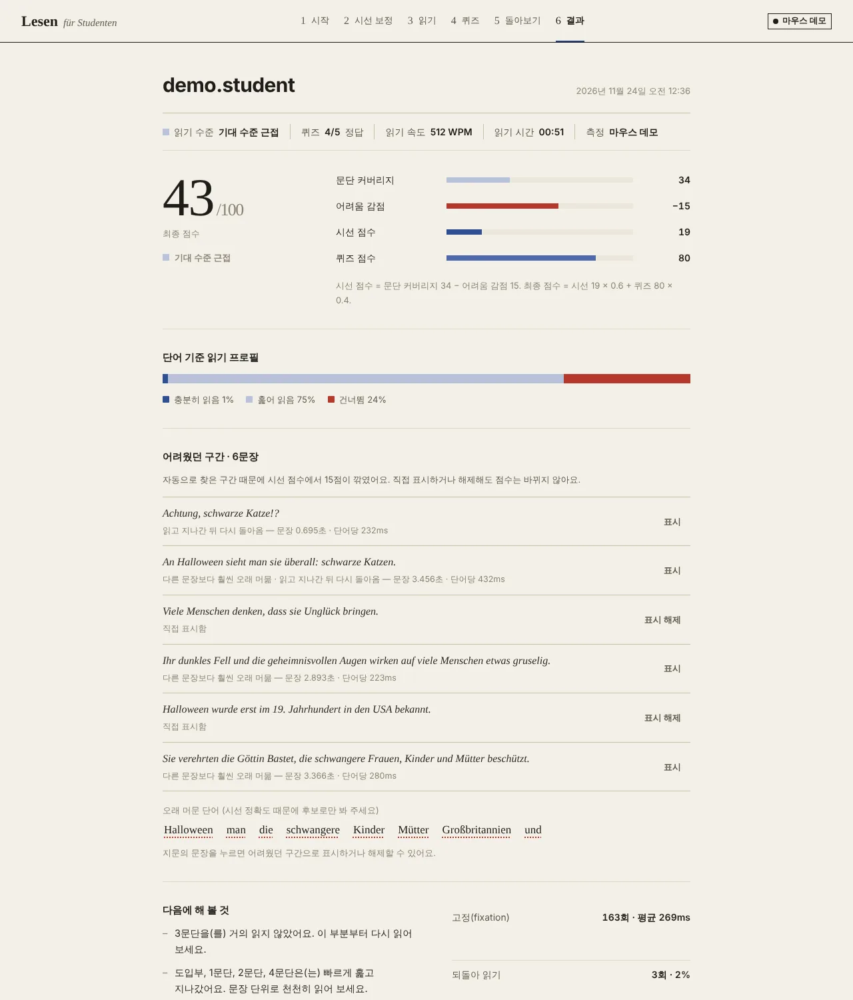
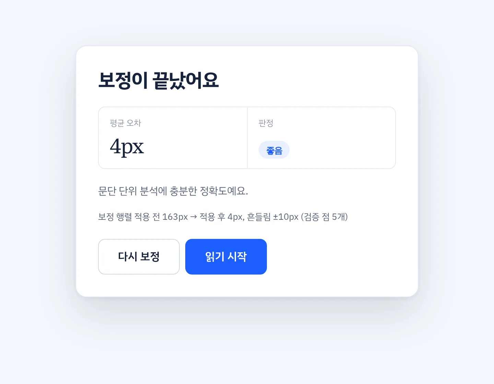
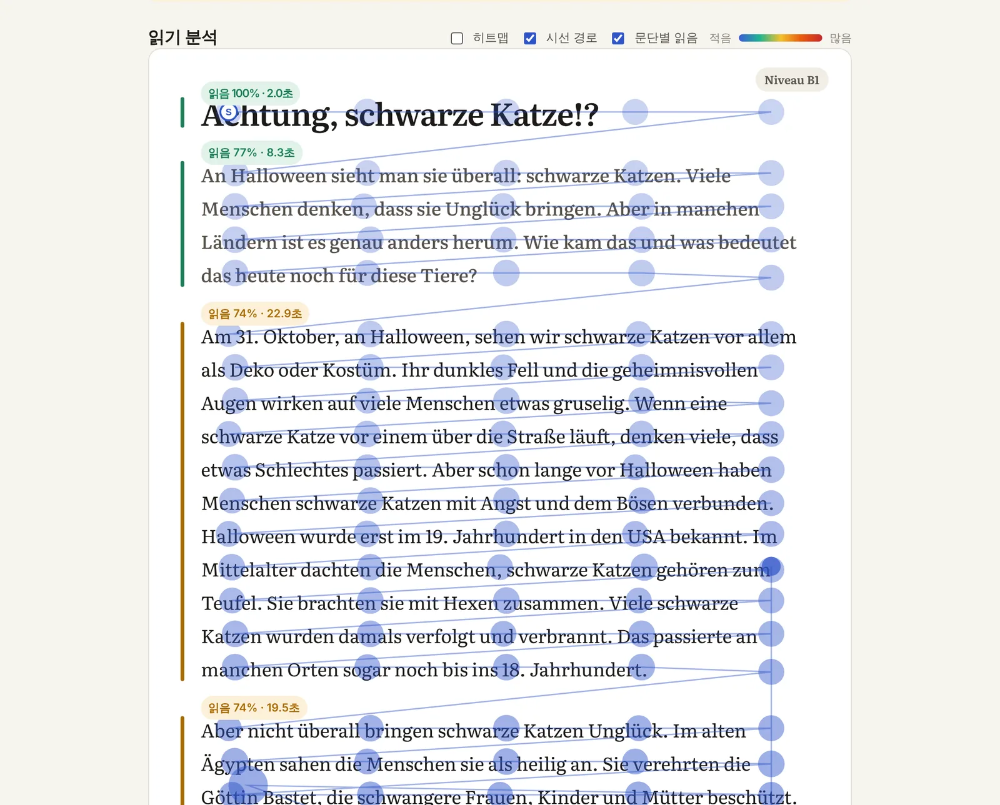
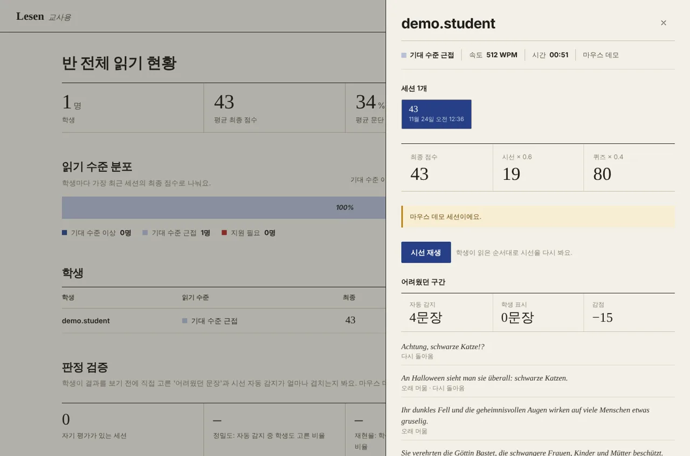
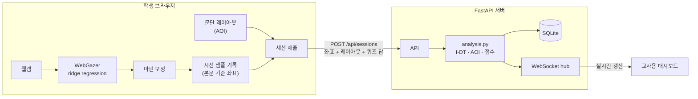

# Lesen für Studenten

웹캠 시선 추적으로 **독일어 읽기 과정**을 기록하고 분석하는 웹 애플리케이션입니다.
학생이 기사를 읽는 동안 시선이 어느 문단에 얼마나 머물렀는지, 어디를 건너뛰고 어디로 되돌아갔는지를 측정하고, 내용 퀴즈와 합쳐 점수를 냅니다. 교사는 대시보드에서 반 전체와 학생별 읽기 패턴을 실시간으로 확인합니다.

<p align="center">
  
</p>

## 주요 기능

| | |
|---|---|
| **브라우저 안에서 끝나는 시선 추정** | [WebGazer.js](https://webgazer.cs.brown.edu/)로 시선을 추정합니다. 카메라 영상은 기기를 벗어나지 않고, 서버에는 시선 좌표만 전송됩니다. |
| **검증 가능한 보정** | 9점 클릭 학습 → 9점 응시로 아핀 보정 → **학습에 쓰지 않은 5개 점으로 실제 오차(px)를 측정**합니다. 보정 행렬이 검증 오차를 줄이지 못하면 적용하지 않습니다. |
| **문단 단위 읽기 분석** | I-DT 알고리즘으로 고정(fixation)을 검출하고, 문단별 체류 시간·커버리지, 되돌아 읽기(regression), 읽기 속도(WPM)를 계산합니다. |
| **결과 시각화** | 고정 시간 가중 히트맵, 시선 경로(scanpath), 문단별 읽음 정도를 본문 위에 겹쳐 보여 줍니다. |
| **교사용 대시보드** | 최근 점수 기준 상·중·하 그룹, 학생별 세션 이력과 문단별 지표, 데이터 품질 경고, CSV/JSON 내보내기. WebSocket으로 실시간 갱신됩니다. |
| **마우스 데모 모드** | 카메라 없이 마우스를 시선으로 삼아 전체 흐름을 체험할 수 있습니다. |

<table>
  <tr>
    <td></td>
    <td></td>
  </tr>
  <tr>
    <td></td>
    <td></td>
  </tr>
</table>

## 동작 방식



- 시선 좌표는 **본문(article) 요소의 왼쪽 위 기준**으로 기록합니다. 그래서 스크롤과 무관하게 문단 위치와 바로 비교할 수 있습니다.
- 퀴즈 정답은 서버에만 있고, 채점도 서버가 합니다.

## 분석과 점수

웹캠 시선 추적의 오차는 보통 100–200px로, 단어 하나를 구분하기는 어렵지만 문단은 충분히 구분할 수 있습니다. 그래서 분석 단위를 **문단**으로 잡았습니다.

1. **고정 검출 (I-DT)**: 분산(가로 폭 + 세로 폭)이 120px 이하로 100ms 이상 유지되는 구간을 하나의 고정으로 봅니다. 250ms 넘게 샘플이 끊기면 추적이 끊긴 것으로 보고 구간을 나눕니다.
2. **문단 배정**: 고정 위치가 문단 상자(여유 범위 포함) 안에 있으면 그 문단의 체류 시간에 더합니다.
3. **문단 커버리지**: `min(1, 체류 시간 / 기준 시간)`. 기준 시간은 문단 단어 수를 기준 속도 200 WPM으로 읽을 때 걸리는 시간입니다. 학습자는 이보다 느리게 읽어도 손해가 없고, 대충 훑으면 점수가 낮아집니다.
4. **시선 점수**: 문단 커버리지의 단어 수 가중 평균 × 100.
5. **최종 점수**: `시선 점수 × 0.6 + 퀴즈 점수 × 0.4`.

함께 계산하는 지표:
- 읽기 속도(WPM)
- 평균 고정 시간
- 본문 응시 비율
- 되돌아 읽기: 같은 줄에서 왼쪽으로 80px 이상 이동한 경우와 이전 문단으로 돌아간 경우. 줄바꿈 시선 이동은 제외합니다.
- 데이터 품질 경고: 보정 오차 과다, 수집 빈도 저하, 시선이 대부분 본문 밖에 있는 경우

## 실행

Python 3.11 이상이 필요합니다.

```bash
python -m venv .venv && source .venv/bin/activate
pip install -r backend/requirements.txt
ADMIN_TOKEN=change-me uvicorn backend.main:app --reload --port 8000
```

| 주소 | 용도 |
|---|---|
| `http://localhost:8000/` | 학생 화면 |
| `http://localhost:8000/admin` | 교사용 대시보드 (`ADMIN_TOKEN` 값으로 로그인) |
| `http://localhost:8000/docs` | API 문서 (OpenAPI) |

웹캠은 `localhost`나 HTTPS에서만 쓸 수 있습니다.

### 환경 변수

| 이름 | 기본값 | 설명 |
|---|---|---|
| `ADMIN_TOKEN` | (임의 생성) | 대시보드 로그인 토큰. 비우면 서버를 켤 때마다 새로 만들어 로그에 출력합니다. |
| `DB_PATH` | `data/lesen.db` | SQLite 파일 경로 |
| `ALLOWED_ORIGINS` | (없음) | 다른 도메인에서 API를 부를 때 허용할 origin 목록 (쉼표로 구분) |

### 배포 (Render 예시)

- Build: `pip install -r backend/requirements.txt`
- Start: `uvicorn backend.main:app --host 0.0.0.0 --port $PORT`
- 환경 변수 `ADMIN_TOKEN`을 설정합니다.
- 무료 인스턴스의 디스크는 재배포 때 초기화됩니다. 데이터를 계속 보관하려면 Persistent Disk를 붙이고 `DB_PATH`를 그 경로로 지정하세요.

## 테스트

```bash
pip install -r requirements-dev.txt
pytest
```

E2E 시나리오(Playwright, 서버 실행 중):

```bash
# 마우스 데모로 읽기 → 퀴즈 → 결과 → 대시보드
BASE=http://localhost:8000 ADMIN_TOKEN=change-me node tests/e2e/demo-flow.mjs out/
# 오차를 일부러 섞은 가짜 WebGazer로 보정 절차와 아핀 보정 검증
BASE=http://localhost:8000 node tests/e2e/calibration-stub.mjs out/
```

## 프로젝트 구조

```
backend/
  main.py          API 라우트, 관리자 인증, WebSocket
  analysis.py      고정 검출, 문단 분석, 점수
  content/         기사·퀴즈 (JSON)
  db.py            SQLite 저장소
frontend/
  index.html       학생 화면
  admin.html       교사용 대시보드
  js/              tracker · calibration · overlay · student · admin
tests/             pytest (분석·API), e2e (Playwright)
```

## 수업 프로젝트에서 바뀐 점

처음 버전은 수업 과제로 만들었고, 이후 구조를 다시 짰습니다.

| 이전 | 현재 | 이유 |
|---|---|---|
| 서버에서 YOLOv8-Pose로 '시선'을 구해 WebGazer와 가중 평균 | 서버 추론 제거, 브라우저에서만 추정 | YOLO 출력은 두 눈 키포인트의 중점, 즉 **머리 위치**였습니다. 이를 섞으면 오히려 정확도가 떨어졌고, 초당 15장의 프레임을 서버로 보내는 비용도 들었습니다. |
| 60×100 격자 중 시선이 닿은 칸 비율로 점수 계산 | 문단별 체류 시간 / 기준 읽기 시간 | 이전 방식은 화면을 아무렇게나 훑을수록 점수가 높았습니다. |
| 목표점 50px 안에 들어와야만 보정 샘플을 수집 | 무조건 수집 후 중앙값 사용, 별도 검증 점으로 오차 측정 | 이전 방식은 오차가 크면 끝나지 않았고, 이미 맞는 샘플만 모여 보정 효과가 없었습니다. |
| 메모리 저장 | SQLite | 서버를 재시작하면 데이터가 사라졌습니다. |
| 관리자 토큰을 README에 공개, 학생별 내보내기는 인증 없음 | 환경 변수 토큰, 모든 관리 API 인증 | 보안 |
| `innerHTML`로 사용자 ID 출력 | DOM API로 텍스트만 삽입, ID 형식 검증 | XSS 방지 |
| 퀴즈 1문항 (0점 또는 100점) | 5문항, 서버 채점 | 변별력 |

## 한계

- 웹캠 시선 추적은 조명, 안경, 자세에 민감합니다. 줄 단위 이하 지표(같은 줄 안의 되돌아 읽기)는 추정치로 보아야 합니다.
- 읽는 도중 창 크기를 바꾸면 문단 위치가 달라져 분석이 어긋납니다.
