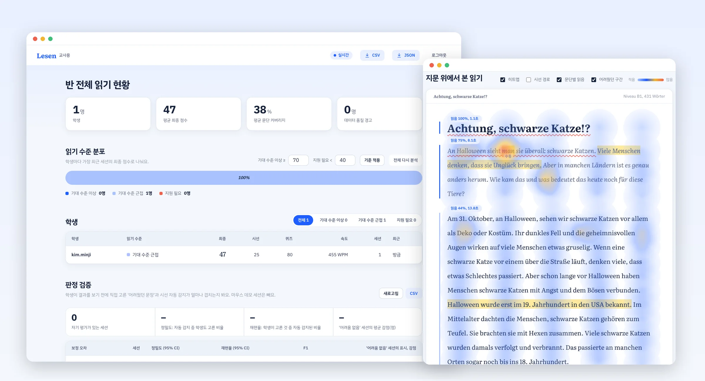
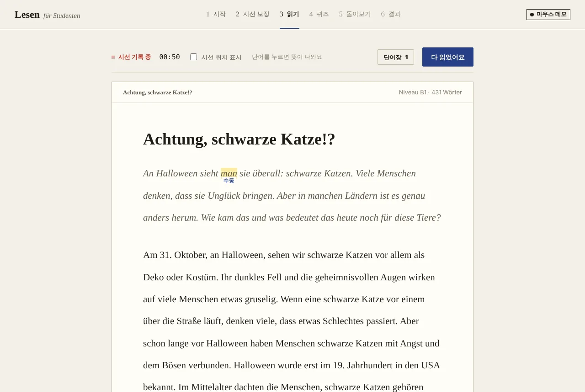
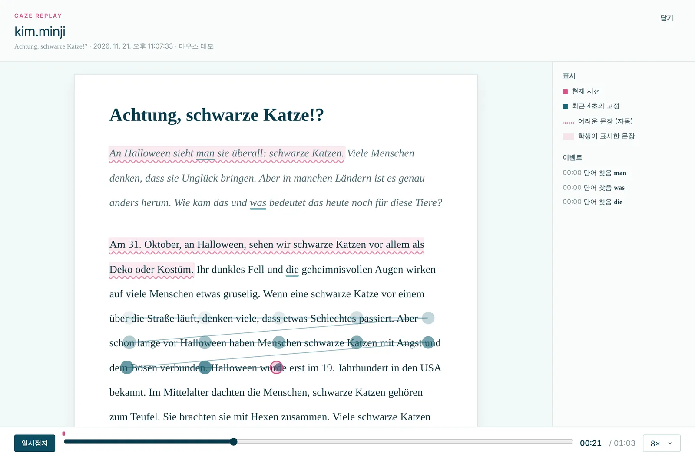
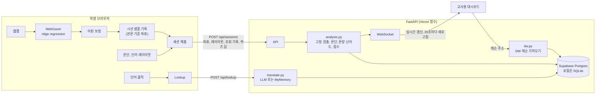

<div align="center">


# Lesen für Studenten

**웹캠 시선으로 독일어 읽기 과정을 보여 주는 읽기 연습 도구**

독일어 기사를 읽는 동안 시선을 기록해서,<br/>
**어느 문단을 건너뛰었는지, 어느 문장에서 막혔는지** 퀴즈 결과와 함께 보여 줘요.

[](https://github.com/GHLee1016/Lesen-Fuer-Studenten/actions/workflows/ci.yml)
[](https://fastapi.tiangolo.com/)
[](https://webgazer.cs.brown.edu/)
[](https://supabase.com/)
[](https://lesen-fuer-studenten-two.vercel.app)
[](tests/e2e)

[서비스 열기](https://lesen-fuer-studenten-two.vercel.app) &nbsp; [판정 기준 조정 기록](docs/tuning.md) &nbsp; [수업 버전에서 바뀐 점](#수업-버전에서-바뀐-점)

수업 과제로 만들었던 프로젝트를 혼자 다시 설계하고 만든 개인 포트폴리오 프로젝트



<sub>학생 결과 화면(앞)과 교사용 대시보드(뒤)예요. 화면 속 기록은 마우스 데모로 만든 예시예요.</sub>

</div>

## 화면

<div align="center">

### 시작, 시선 보정, 읽기
 


### 결과 리포트
 

### 교사용 대시보드와 시선 재생
 

</div>

카메라가 없어도 [서비스](https://lesen-fuer-studenten-two.vercel.app)에서 **마우스 데모**를 고르면 마우스 위치를 시선으로 삼아 같은 과정을 해 볼 수 있어요. 교사용 화면(`/admin`)은 관리자 토큰이 있어야 열려요.

## Lesen이 하는 일

외국어 읽기 시험은 보통 점수 하나만 남겨서, 학생이 **어디서 막혔는지**는 알기 어려워요.
Lesen은 읽는 동안의 시선을 문단과 문장 단위로 정리해서, 같은 점수라도 읽는 방식이 어떻게 달랐는지 보여 줘요.

- **진단하지 않아요.** 왜 그렇게 읽었는지는 말하지 않고, 기록에서 확인한 것만 보여 줘요.
- **카메라 영상을 서버에 보내지 않아요.** 시선은 브라우저 안에서 추정하고, 화면 위 좌표만 저장해요.
- **확실하지 않으면 감점하지 않아요.** 보정 오차가 크면 감점을 줄이거나 하지 않아요.
- **학생이 직접 고른 표시는 점수에 넣지 않아요.** 어려웠던 문장을 솔직하게 고를 수 있게요.

## 주요 기능

### 시선 추정과 보정
- **브라우저 안에서 추정:** [WebGazer.js](https://webgazer.cs.brown.edu/)로 초당 약 30번 시선을 추정해요.
- **검증할 수 있는 보정:** 점 9개를 누르며 학습하고, 점 9개를 바라보며 아핀 보정을 한 뒤, **학습에 쓰지 않은 점 5개로 실제 오차(px)를 재요.** 보정이 오차를 줄이지 못하면 적용하지 않아요.
- **흔들림 측정:** 점을 바라보는 동안 시선이 흩어진 정도를 재서, 분석 기준을 그 세션에 맞게 넓혀요.

### 읽는 동안
- **단어 뜻풀이:** 단어를 누르면 고른 언어(14개)로 뜻이 단어 아래에 달려요. LLM 키가 있으면 문맥을 보고 기본형, 관사, 품사까지 알려 줘요.
- **단어장:** 찾아본 단어가 예문과 함께 모이고, CSV로 내려받아 Anki 같은 앱에 넣을 수 있어요.
- **돌아보기:** 퀴즈 뒤, 결과를 보기 전에 어려웠던 문장을 직접 골라요. 자동 판정에 끌려가지 않은 기준 데이터가 돼요.

### 결과 리포트
- **점수 구성:** 문단 커버리지, 어려움 감점, 시선 점수, 퀴즈 점수를 막대로 나눠 보여 줘요.
- **어려웠던 구간:** 내 평소 속도보다 훨씬 오래 머문 문장, 지나간 뒤 다시 돌아온 문장을 찾아 이유와 시간을 함께 보여 줘요.
- **지문 위 지도:** 고정 시간 가중 히트맵, 시선 경로, 문단별 읽음 정도, 어려웠던 문장을 본문 위에 겹쳐 봐요.
- **다음에 해 볼 것:** 건너뛴 문단, 너무 빨랐던 문단, 틀린 퀴즈에 맞춘 안내.

### 교사용 대시보드
- **반 전체:** 최근 점수 기준 읽기 수준 분포, 학생 표, 데이터 품질 경고, CSV와 JSON 내보내기.
- **학생별:** 세션 이력, 문단별 지표, 찾아본 단어, 어려웠던 문장.
- **시선 재생:** 학생이 본 화면 폭 그대로 지문을 다시 그리고 시선을 시간 순서대로 재생해요. 단어를 찾아본 시점이 타임라인에 표시돼요.
- **판정 검증:** 학생의 자기 표시와 자동 판정이 얼마나 겹치는지 보정 오차 구간별로 보고, 저장된 시선 데이터로 기준 후보를 다시 돌려 적용할 수 있어요.

### 지문
- **DW Deutsch lernen 가져오기:** 레슨 주소를 넣으면 본문, CEFR 수준(A1~C1), 용어 풀이, 이해도 문제를 가져와요.

## 구조



| 무엇 | 어디서 | 왜 |
|---|---|---|
| 시선 추정과 보정 | 학생 브라우저 | 카메라 영상을 기기 밖으로 보내지 않으려고 |
| 고정 검출, 판정, 점수 | 서버 코드 | 같은 기록에는 항상 같은 결과가 나오고, 기준을 바꾸면 저장된 세션을 다시 계산할 수 있게 |
| 퀴즈 채점 | 서버 코드 | 정답을 화면에 보내지 않으려고 |
| 단어 뜻풀이 | LLM 또는 MyMemory | 판정에는 관여하지 않고 뜻만 다는 데 써요. 결과는 DB에 캐시해요 |

시선 좌표는 본문 요소의 왼쪽 위를 기준으로 저장해서, 스크롤과 상관없이 문단 위치와 바로 비교해요.

## 분석과 점수

웹캠 시선 추적의 오차는 보통 100~200px이라 단어 하나는 정확히 가리기 어렵지만, 문장과 문단은 구분할 수 있어요. 그래서 점수는 **문단**과 **문장** 단위로 내고, 단어 단위 결과는 참고용 후보로만 써요. 줄 간격을 2.3배로 넓혀 줄을 구분하기 쉽게 했어요.

1. **고정 검출 (I-DT):** 분산(가로 폭 + 세로 폭)이 기준 이하로 100ms 이상 유지되면 하나의 고정이에요. 기준은 120px이고, 보정 때 잰 흔들림이 크면 흔들림의 6배까지 넓혀요.
2. **문단 커버리지:** `min(1, 체류 시간 / 기준 시간)`. 기준 시간은 문단을 분당 200단어로 읽을 때 걸리는 시간이에요. 천천히 읽어도 손해가 없고, 대충 훑으면 낮아져요.
3. **어려웠던 구간:** 고정을 가장 가까운 단어에 배정하고 문장 단위로 모아요.
   - **오래 머문 문장:** 단어당 시간이 그 학생의 문장 중앙값의 2배 이상, 5단어 이상, 1.2초 이상
   - **다시 읽은 문장:** 지금까지 읽은 가장 아래 줄보다 2줄 이상 위로 돌아가 0.5초 이상 머문 문장
   - **단어 후보:** 단어 체류 시간 중앙값의 3.5배(최소 0.7초) 이상. 보정 오차 40px 이하일 때만 보여 줘요.
4. **감점:** `min(25, 40 × 어려운 문장 단어 비율 + 1.5 × 단어 후보 수) × 신뢰도`. 신뢰도는 보정 오차 60px까지 1이고 150px에서 0이 돼요.
5. **시선 점수:** `문단 커버리지(단어 수 가중 평균) × 100 − 감점`
6. **최종 점수:** `시선 점수 × 0.6 + 퀴즈 점수 × 0.4`. 퀴즈가 없는 지문은 시선 점수가 최종 점수예요.

학생 자신의 평소 속도를 기준으로 삼아서, 원래 천천히 읽는 학생이 불리하지 않아요. 기준을 바꾸면 대시보드의 **전체 다시 분석**으로 저장된 세션을 다시 계산해요.

## 재 본 숫자

지어낸 목표값이 아니라 직접 잰 값이에요. 실제 학생 웹캠 데이터는 아직 모으는 중이라, 판정 정확도는 **웹캠 잡음을 섞은 가상 독자**로 잰 값이에요([조정 기록](docs/tuning.md)).

| 항목 | 값 | 조건 |
|---|---|---|
| 어려움 없는 독자가 받은 감점 | 조정 전 21.9점 → 조정 후 0.4점 | 오차 약 50px, 조정에 쓰지 않은 가상 독자 24명 |
| 같은 감점, 오차가 큰 경우 | 조정 전 25점(상한) → 조정 후 1.0점 | 오차 약 100px |
| 어려운 문장 찾기 정밀도, 재현율 | 0.49, 0.38 | 오차 약 50px. 오차가 없으면 1.00, 0.89 |
| 문단 커버리지 | 0.68~0.70 | 오차 50px, 100px, 160px에서 비슷하게 유지(오차가 없으면 0.79) |
| 아핀 보정 효과 | 검증 오차 약 160px → 4px | 일부러 오차를 섞은 가짜 WebGazer(E2E 테스트) |
| 자동 테스트 | pytest 58개, E2E 2개 | GitHub Actions가 PR마다 SQLite와 Postgres에서 각각 돌려요 |

오차가 있을 때 문장 하나를 정확히 짚는 능력(0.3~0.5)은 아직 낮아요. 그래서 오차가 클수록 감점을 줄이고, 학생의 자기 표시로 실제 정확도를 확인하는 판정 검증 기능을 만들었어요.

## 수업 버전에서 바뀐 점

처음 버전은 수업 과제로 만들었고, 이후 혼자 구조를 다시 짰어요.

| 이전 | 현재 | 이유 |
|---|---|---|
| 서버에서 YOLOv8-Pose로 '시선'을 구해 WebGazer와 가중 평균 | 서버 추론을 없애고 브라우저에서만 추정 | YOLO 출력은 두 눈 키포인트의 중점, 즉 **머리 위치**였어요. 섞으면 오히려 정확도가 떨어졌고, 초당 15장을 서버로 보내는 비용도 들었어요. |
| 60×100 격자 중 시선이 닿은 칸 비율로 점수 | 문단별 체류 시간 / 기준 읽기 시간 | 이전 방식은 화면을 아무렇게나 훑을수록 점수가 높았어요. |
| 목표점 50px 안에 들어와야만 보정 샘플 수집 | 모두 모은 뒤 중앙값, 별도 검증 점으로 오차 측정 | 이전 방식은 오차가 크면 끝나지 않았고, 이미 맞는 샘플만 모여 보정 효과가 없었어요. |
| 메모리 저장 | 로컬은 SQLite, 배포는 Supabase Postgres | 서버를 재시작하면 데이터가 사라졌어요. |
| 관리자 토큰을 README에 공개 | 환경 변수 토큰, 모든 관리 API 인증 | 보안 |
| `innerHTML`로 사용자 ID 출력 | DOM API로 텍스트만 넣고 ID 형식 검증 | XSS 방지 |
| 퀴즈 1문항 (0점 또는 100점) | 5문항, 서버 채점 | 변별력 |
| 테스트 없음 | pytest, Playwright E2E, GitHub Actions | 판정 기준을 바꿔도 안전하게 |

## 기술

<table>
<tr>
<td valign="top">

**화면**
- Vanilla JS (ES 모듈)
- WebGazer.js
- Canvas (히트맵, 재생)
- Literata, IBM Plex Sans KR

</td>
<td valign="top">

**서버**
- FastAPI
- Vercel 함수
- Supabase Postgres
- SQLite (로컬)
- psycopg 연결 풀

</td>
<td valign="top">

**분석**
- I-DT 고정 검출
- 아핀 보정 (최소제곱)
- 웹캠 잡음 시뮬레이터
- Wilson 신뢰구간

</td>
<td valign="top">

**품질**
- pytest
- Playwright E2E
- GitHub Actions
- SQLite, Postgres 둘 다 테스트

</td>
</tr>
</table>

## 빠른 시작

### 준비물
- Python 3.11 이상
- E2E 테스트를 돌릴 때만 Node 18 이상과 Playwright

### 1. 받기
```bash
git clone https://github.com/GHLee1016/Lesen-Fuer-Studenten.git
```

```bash
cd Lesen-Fuer-Studenten
```

### 2. 서버 켜기
```bash
pip install -r backend/requirements.txt
```

```bash
ADMIN_TOKEN=change-me uvicorn backend.main:app --reload --port 8000
```

http://localhost:8000 이 학생 화면, http://localhost:8000/admin 이 교사용 대시보드(`ADMIN_TOKEN`으로 로그인)예요. 웹캠은 localhost나 https에서만 켜져요.

### 3. 테스트
```bash
pip install -r requirements-dev.txt
```

```bash
pytest
```

같은 테스트를 Postgres에서 돌릴 때는 빈 테스트용 DB를 써요(테스트마다 모든 표를 지워요).

```bash
TEST_DATABASE_URL=postgresql://postgres@localhost:5432/lesen_test pytest
```

### 4. E2E (서버를 켠 상태에서)
```bash
BASE=http://localhost:8000 ADMIN_TOKEN=change-me node tests/e2e/demo-flow.mjs out/
```

```bash
BASE=http://localhost:8000 node tests/e2e/calibration-stub.mjs out/
```

첫 번째는 마우스 데모로 읽기, 단어 조회, 퀴즈, 돌아보기, 결과, 대시보드, 시선 재생까지 돌려요. 두 번째는 오차를 섞은 가짜 WebGazer로 보정 절차를 확인해요.

### 5. 판정 기준 도구
```bash
python -m tools.tune report
```

```bash
DB_PATH=data/demo.db python -m tools.seed_demo 24
```

```bash
DB_PATH=data/demo.db python -m tools.compare --whatif
```

`tune`은 가상 독자로 판정 기준을 재고, `seed_demo`는 판정 검증 화면을 시험할 가상 세션(`sim-`으로 시작)을 넣고, `compare`는 저장된 세션으로 검증 보고서를 만들어요.

## 배포 (Vercel과 Supabase)

### Supabase
- 새 프로젝트를 만들고, **Connect**에서 **Transaction pooler** 연결 문자열(포트 6543)을 복사해요. `db.xxxx.supabase.co:5432` 직접 연결은 Vercel에서 붙지 않아요.
- 표는 앱이 처음 요청을 받을 때 자동으로 만들고, 모든 표에 RLS를 켜요. 공개 Data API로는 학생 데이터를 읽을 수 없어요.
- 무료 프로젝트는 일주일 동안 활동이 적으면 일시 정지돼요. 대시보드에서 다시 켜면 데이터는 그대로예요.

### Vercel
- 저장소를 가져오면 `pyproject.toml`의 `[tool.vercel] entrypoint`가 `backend.main:app`을 가리켜요. **Root Directory는 비워 두세요.** `backend`로 두면 함수가 시작하자마자 실패해요.
- 환경 변수를 바꾼 뒤에는 Redeploy가 필요해요. 배포 상태는 `/api/health`로 확인해요(`ok`, 쓰는 DB, `ADMIN_TOKEN` 설정 여부).
- Function Region을 Supabase 리전과 가깝게 두면 응답이 빨라져요.

### 환경 변수
Vercel 대시보드에서만 다루고, 채팅이나 저장소에 올리지 않아요.

| 이름 | 내용 |
|---|---|
| `ADMIN_TOKEN` | 교사용 대시보드 토큰. 배포에서는 꼭 정해요. 비우면 인스턴스마다 다른 토큰이 생겨 로그인이 안 돼요 |
| `DATABASE_URL` | Supabase 연결 문자열. 없으면 SQLite(`DB_PATH`, 기본 `data/lesen.db`)를 써요 |
| `ANTHROPIC_API_KEY` | 선택. 문맥에 맞는 단어 뜻풀이. 없으면 무료 MyMemory로 단어만 번역해요 |
| `LESEN_TRANSLATE_MODEL` | 선택. 뜻풀이에 쓸 모델 이름 |
| `DB_POOL_SIZE`, `DB_TIMEOUT` | 선택. Postgres 연결 풀 크기(기본 4), 연결 대기 시간(기본 8초) |
| `ALLOWED_ORIGINS` | 선택. 다른 도메인에서 API를 부를 때 허용할 origin(쉼표로 구분) |

## 폴더

```
Lesen-Fuer-Studenten/
├── backend/
│   ├── main.py              # API, 관리자 인증, WebSocket, /api/health
│   ├── analysis.py          # 고정 검출, 문단 분석, 문장과 단어 난이도, 점수
│   ├── params.py            # 대시보드에서 바꾼 판정 기준
│   ├── validation.py        # 자기 표시와 자동 판정 비교, 기준 후보 비교
│   ├── reanalyze.py         # 저장된 세션을 현재 기준으로 다시 계산
│   ├── sim.py               # 웹캠 잡음을 섞은 가상 독자
│   ├── dw.py                # DW 레슨 가져오기
│   ├── translate.py         # 단어 뜻풀이 (LLM, MyMemory)
│   ├── db.py                # 저장소 (SQLite, DATABASE_URL이 있으면 Postgres)
│   └── content/             # 기본 지문과 퀴즈
├── frontend/
│   ├── index.html           # 학생 화면
│   ├── admin.html           # 교사용 대시보드
│   ├── css/                 # 공통, 지문(학생 화면과 재생이 공유), 학생, 교사
│   └── js/                  # tracker, calibration, article, overlay, vocab, student, admin, replay
├── tools/                   # tune(기준 측정), compare(검증 보고서), seed_demo(가상 세션)
├── tests/                   # pytest, e2e (Playwright)
├── docs/                    # tuning.md, 스크린샷
├── pyproject.toml           # Vercel 설정 (의존성은 backend/requirements.txt와 같게)
└── .github/workflows/ci.yml # PR마다 테스트
```

## 지켜야 할 것

- 판정과 점수는 서버 코드가 내요. LLM은 단어 뜻풀이에만 쓰고, 시선 데이터나 점수를 보내지 않아요.
- 카메라 영상과 얼굴 이미지는 저장하거나 전송하지 않아요. 저장하는 건 시선 좌표, 문단과 단어 위치, 퀴즈 답, 찾아본 단어, 보정 오차예요.
- 지문 글꼴을 바꾸면 그 전에 저장된 세션은 시선 재생에서 줄이 조금 어긋나요. 재생은 학생이 본 폭 그대로 다시 그리기 때문에, 모든 기기에서 같은 웹 글꼴을 써요.
- DW에서 가져온 지문은 실행 중인 서버의 DB에만 저장하고 원문 링크를 함께 보여 줘요. 저장소에는 기본 지문 하나만 있어요. 공개 운영 전에는 [DW 이용 약관](https://learngerman.dw.com/de/impressum/a-57669411)을 확인하세요.
- 단어장은 학생 ID만으로 조회돼요. 학생 ID는 추측하기 어렵게 정하는 걸 권해요.

## 한계

- 웹캠 시선 추적은 조명, 안경, 자세에 민감해요. 단어 단위 결과와 같은 줄 안의 되돌아 읽기는 추정치예요.
- 읽는 도중 창 크기를 바꾸면 문단과 단어 위치가 달라져 분석이 어긋나요.
- MyMemory 뜻풀이는 문맥을 보지 않아 `man`, `was` 같은 기능어에서 엉뚱한 뜻이 나올 수 있어요.

## 다음 계획

- [ ] **실제 웹캠 데이터 모으기:** 학생 여러 명의 세션과 자기 표시로 판정 정확도를 다시 재고 기준 조정
- [ ] **줄 배정 알고리즘:** 시선이 한두 줄씩 어긋나는 문제를 줄 끝에서 처음으로 돌아가는 시선(return sweep) 기준으로 보정
- [ ] **단어장 접근 보호:** 학생 ID만으로 조회되지 않게 간단한 인증 추가
- [ ] **지문 늘리기:** 수준별 DW 레슨 묶음 준비

## 쓴 데이터와 도구

- **Deutsche Welle** Deutsch lernen (지문, 수준, 용어 풀이, 이해도 문제)
- **WebGazer.js** (브라운 대학교), **MyMemory** 번역 API
- **FastAPI**, **psycopg**, **Supabase**, **Vercel**
- **Playwright**, **pytest**, **GitHub Actions**
- **Literata**, **IBM Plex Sans KR** (Google Fonts)
